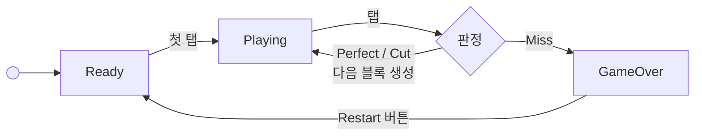
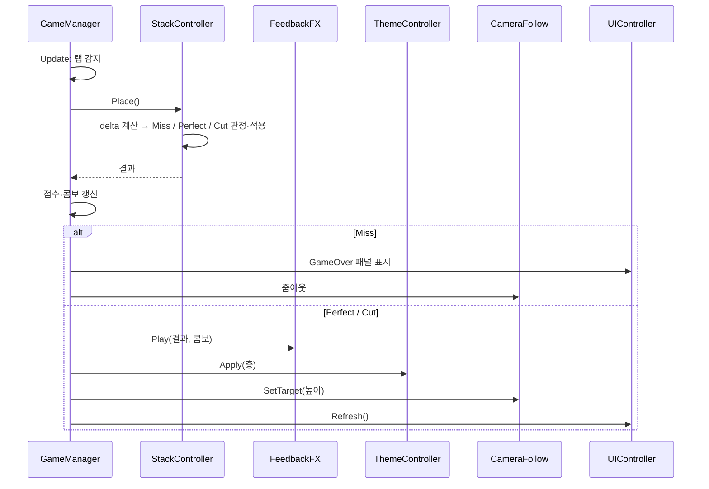

# Stack 기획서

## 1. 개요

| 항목    | 내용                                                        |
| ----- | --------------------------------------------------------- |
| 장르    | 원탭 하이퍼캐주얼 (Ketchapp *Stack* 계열)                           |
| 엔진    | Unity (3D URP, Input System)                              |
|       | 좌우로 왕복하는 블록을 탭해 쌓고, 어긋난 만큼 잘려 나감. 더 이상 쌓을 수 없으면 게임 오버, |
| 목표    | 코드 구조를 전부 파악할 수 있는 규모로 1시간 안에 완성                          |
| 핵심 가치 | **조작감**: 입력 즉시 반응, 약간의 snap -> 플레이어가 잘한다는 느낌 제공           |

**범위 밖:** 광고, 상점, 스킨, 랭킹 서버, 튜토리얼, 사운드 에셋 제작.

## 2. 핵심 루프

## 3. 규칙

### 3.1 월드 구성
- **3D 큐브 + 직교 카메라.** 카메라는 약 yaw 45° / pitch 35°의 쿼터뷰.
- 블록 크기는 `(width, height, depth)`. 높이는 고정(0.5), 폭·깊이만 줄어든다.
- 시작 블록(바닥)은 3 × 3, 원점에 고정.

### 3.2 이동
- 층이 짝수면 **X축**, 홀수면 **Z축**으로 번갈아 움직인다.
- 새 블록은 직전 블록 중심에서 축 방향으로 `spawnOffset` 떨어진 곳에서 시작해 **등속 왕복**한다. 시작 쪽(- 또는 +)은 블록마다 **무작위**이고, 중앙을 향해 먼저 움직인다.
	- 가속 곡선은 쓰지 않는다(속도가 읽혀야 맞췄다는 확신이 생김).
- 속도는 층마다 `speedStep`씩 올라 `speedMax`에서 멈춘다.
- 이동 범위는 직전 블록 중심 기준 ±`moveRange`.

### 3.3 탭 판정
탭 순간의 `delta = 움직이는 블록 중심 − 직전 블록 중심` (이동 축 방향 값)으로 판정한다.

| 조건  | 결과                                       |                     |                                                |
| --- | ---------------------------------------- | ------------------- | ---------------------------------------------- |
| `   | delta                                    | ≥ 직전 블록 크기(해당 축)`   | **Miss** → 블록이 낙하, 게임 오버                       |
| `   | delta                                    | ≤ perfectTolerance` | **Perfect** → 위치를 직전 블록에 맞춰 snap, 크기 유지, 콤보 +1 |
| 그 외 | **Cut** → 겹친 부분만 남기고 나머지는 조각으로 떨어짐, 콤보 0 |                     |                                                |

**Cut 계산 (이동 축 기준)**
- 새 크기 = `직전 크기 − |delta|`
- 새 중심 = `직전 중심 + delta / 2`
- 잘린 조각 크기 = `|delta|`, 중심은 새 블록의 바깥쪽 끝에 붙인다.
- 잘린 조각은 Rigidbody를 달아 떨어뜨리고 `cutLifetime`초 뒤 제거한다.

### 3.4 콤보 보상 (확장)
- Perfect가 `growStartCombo`회 이상 연속되면, Perfect마다 블록이 `growAmount`만큼 넓어진다(이동 축 방향, 양쪽 대칭).
- 폭은 시작 크기(3)를 넘지 않는다.
- Cut이 한 번이라도 나면 콤보가 0이 되어 보상이 끊긴다.

### 3.5 점수
- **점수 = 쌓은 층수** (시작 블록 제외, 성공 판정마다 +1).
- **콤보 = 연속 Perfect 횟수.** 점수와 별도로 표시한다.
- **최고점**은 `PlayerPrefs`에 저장한다(키: `BestScore`).

### 3.6 게임 오버
- Miss 판정 시 블록이 떨어지는 것을 `gameOverDelay`초 보여준 뒤 게임 오버 화면을 띄운다.
- 이때 카메라 `orthographicSize`를 키워 쌓은 탑 전체가 보이게 한다.

## 4. 조작감

원칙: **입력은 즉시 처리하고, 판정은 플레이어에게 살짝 유리하게 보정한다.**

| 장치 | 내용 | 비고 |
|---|---|---|
| 즉시 판정 | `wasPressedThisFrame`에서 바로 정지·판정. release 대기, 애니메이션 대기 없음 | 입력 지연 0 |
| Perfect snap | `|delta| ≤ perfectTolerance`면 완벽한 정렬로 간주해 위치 보정, 자르지 않음 | **가장 효과가 큼.** 1.0 기준 ≈ 3% 폭 |
| 콤보 보상 | 3.4의 폭 회복 | 잘할수록 쉬워지는 느낌 |
| 착지 바운스 | 쌓인 블록이 `bounceDepth`만큼 눌렸다가 `bounceTime` 동안 복귀 (ease-out) | 무게감, 탭 확인 피드백 |
| Perfect 링 | 쌓은 블록 외곽 복제본이 1.0 → 1.3배로 커지며 투명해짐(`ringTime`) | Perfect 확인용 |
| 콤보 음높이 | 콤보마다 pitch +1 반음, 최대 +12 | 사운드는 코드로 만든 사인파 비프로 대체 가능 |
| hit-stop | Perfect 시 0.04초(`hitStopTime`) `timeScale` 0, 실시간 기준으로 복귀 | 어색하면 값을 줄이거나 0 |

> [!note] 튜닝 순서
> `perfectTolerance` → 바운스 → 링 → 사운드 순으로 조정한다. snap이 너무 크면 Cut이 거의 안 나오니, 플레이해 보며 값을 줄여 나간다.

## 5. 연출·아트 (리소스 0)

- **블록:** 루트(콜라이더·`Block`) 아래 자식 `Visual`(큐브)로 구성한다. 단색 머티리얼 1개를 공유하고, 층마다 `MaterialPropertyBlock`으로 색만 바꾼다.
  - 색: `Color.HSVToRGB(hue, 0.35, 0.95)`, `hue = (layer × hueStep) % 1`. 파스텔 톤 유지.
- **배경:** 카메라 뒤에 세로 그라데이션(위 라벤더 → 중간 핑크 → 아래 크림)을 깔고, 네 갈래 반짝이 별이 깜빡인다. 그라데이션과 별 스프라이트는 코드로 만든 텍스처(에셋 0). 층이 오르면 그라데이션 색조가 블록 색조의 절반 속도로 천천히 이동한다. 포스트 프로세싱(톤매핑)은 색이 탁해져서 끈다.
- **라이트:** Directional Light 1개, 약한 따뜻한 색, 그림자는 소프트 또는 끔. Ambient는 Gradient 모드로 파스텔 색.
- **카메라:** 탑 높이 + 오프셋을 `SmoothDamp`(≈0.25s)로 따라 올라간다.
- **파티클:** 기본 사각 파티클 몇 개를 떠다니게 하는 정도(선택).
- 그레이스케일은 "에셋 없이 시작하는 기본값"이고, 위 색조 변화는 허용한다.

## 6. UI

| 요소 | 위치 | 동작 |
|---|---|---|
| 점수 | 상단 중앙, 큰 숫자 | 층수 증가 시 짧은 펀치 스케일 |
| 콤보 | 점수 아래 | `PERFECT x3`, 콤보 2 이상부터 표시, 끊기면 페이드아웃 |
| 시작 안내 | 화면 중앙 | "TAP TO START", 첫 탭에 사라짐 |
| 게임 오버 패널 | 전체 오버레이 | 점수, 최고점, **Restart 버튼** |

- Canvas는 Screen Space Overlay, 텍스트는 TextMeshPro.
- 게임 오버 상태에서는 화면 탭이 블록 입력으로 들어가지 않게 막는다. 재시작은 버튼으로만 한다.

## 7. 코드 구조

한 클래스는 한 가지 이유로만 바뀌게 나눈다. 판정 수식은 `StackController.Place()` 안에서 `Mathf`로 직접 계산한다. 블록의 위치·크기(판정에 쓰는 값)는 `StackController`만 바꾸고, 보이기만 하는 연출(바운스)은 `Block`이 자기 자식 비주얼에만 적용한다.

| 클래스 | 책임 | 알고 있는 것 |
|---|---|---|
| `GameManager` | 상태(Ready/Playing/GameOver), 점수·콤보·최고점, 입력 수신, 각 모듈 호출 순서 조율 | 아래 모든 모듈 |
| `StackController` | 블록 생성·이동·정지, `Miss / Perfect / Cut` 판정과 적용, 잘린 조각 생성 | `Block`, `ThemeController`(색 조회만) |
| `Block` | 블록 하나의 색칠, 바운스 연출(자식 `Visual`만 이동), 낙하(Rigidbody) | 없음 |
| `CameraFollow` | 탑 높이 추적, 게임 오버 줌아웃 | 탑 높이 |
| `ThemeController` | 층별 블록 색, ambient·태양 색 보간, 배경에 색조 변화량 전달 | `BackgroundController` |
| `BackgroundController` | 그라데이션 배경, 반짝이 별(에셋 없이 코드로 생성) | 카메라 |
| `FeedbackFX` | Perfect 링, 사운드, hit-stop, 블록에 바운스 요청 | 방금 쌓은 `Block`, 콤보 |
| `UIController` | 점수·콤보·패널 표시, 버튼 이벤트 | `GameManager` 이벤트 |

**데이터 흐름 (탭 1회)**

- `GameManager`가 모듈을 직접 호출하고, 모듈끼리는 서로를 호출하지 않는다(의존 방향 한쪽).
- 입력은 Input System의 `Pointer.current.press.wasPressedThisFrame` 하나로 마우스·터치를 모두 처리한다.

## 8. 구현 순서 (목표 60분)

- [x] **5분** 씬 세팅: 직교 카메라 쿼터뷰, Directional Light, 블록 프리팹(Cube)
- [x] **10분** `StackController` + 왕복 이동 + 탭 시 정지 + 다음 블록 생성(축 교대)
- [x] **10분** Cut / Perfect / Miss 판정, 잘린 조각 낙하
- [x] **5분** `CameraFollow`
- [x] **10분** `GameManager` 상태, 점수·콤보, 게임 오버·재시작
- [x] **10분** `UIController` (점수, 콤보, 게임 오버 패널, 버튼)
- [x] **5분** `ThemeController` (층별 색, 스카이박스·라이트)
- [x] **5분** `FeedbackFX` (바운스, 링, 음높이)

여유가 생기면: 콤보 폭 회복 튜닝, 게임 오버 줌아웃, hit-stop, 파티클.

## 9. 튜닝 파라미터

처음 값은 출발점이고, 플레이하며 조정한다. 인스펙터에 노출한다.

| 이름 | 초기값 | 설명 |
|---|---|---|
| `baseSize` | 3.0 | 시작 블록 폭·깊이 |
| `blockHeight` | 0.5 | 블록 높이 |
| `spawnOffset` | 4.0 | 새 블록 시작 거리 |
| `moveRange` | 4.0 | 왕복 반경 |
| `speedStart` | 3.0 | 시작 속도(u/s) |
| `speedStep` | 0.05 | 층당 속도 증가 |
| `speedMax` | 7.0 | 최대 속도 |
| `perfectTolerance` | 0.1 | Perfect snap 허용 오차(u) |
| `growStartCombo` | 3 | 폭 회복 시작 콤보 |
| `growAmount` | 0.1 | Perfect당 폭 증가(u) |
| `cutLifetime` | 3.0 | 잘린 조각 제거 시간(s) |
| `gameOverDelay` | 0.8 | 낙하 후 패널 표시까지(s) |
| `bounceDepth` | 0.08 | 착지 바운스 깊이(u) |
| `bounceTime` | 0.12 | 바운스 복귀 시간(s) |
| `ringTime` | 0.35 | Perfect 링 지속(s) |
| `hueStep` | 0.02 | 층당 색상 변화 |
| `cameraSmooth` | 0.25 | 카메라 추적 시간(s) |

## 10. 검수 기준

- [ ] 탭한 프레임에 블록이 멈춘다(체감 지연 없음).
- [ ] 거의 맞춘 탭이 Perfect로 snap되어 자르지 않는다.
- [ ] Cut 시 남는 크기와 위치가 시각적으로 정확하다.
- [ ] 완전히 빗나가면 게임 오버, 재시작 시 모든 상태가 초기화된다.
- [ ] 연속 Perfect에서 콤보 UI와 폭 회복이 동작한다.
- [ ] 60층 이상 쌓아도 프레임 저하가 없다(블록·조각 정리 확인).
- [ ] 최고점이 앱 재실행 후에도 유지된다.
